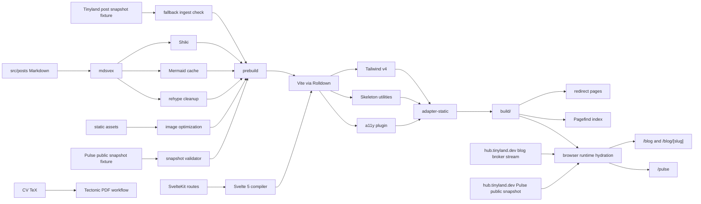
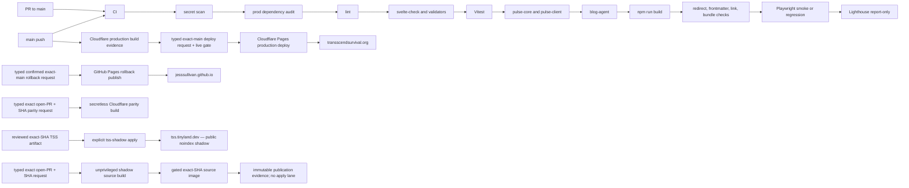
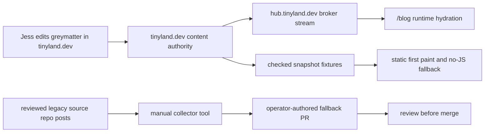
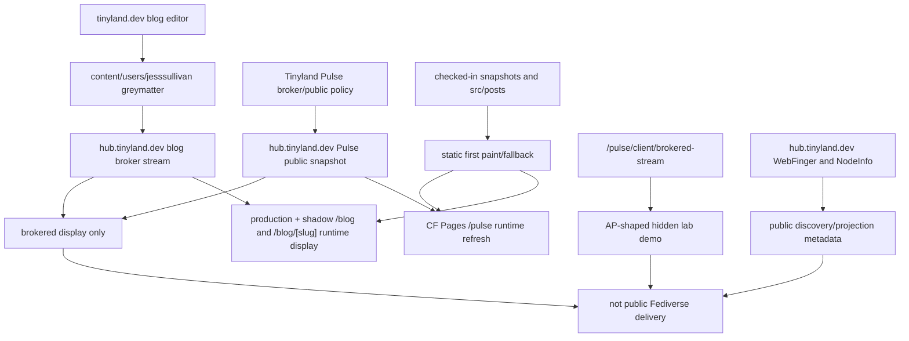
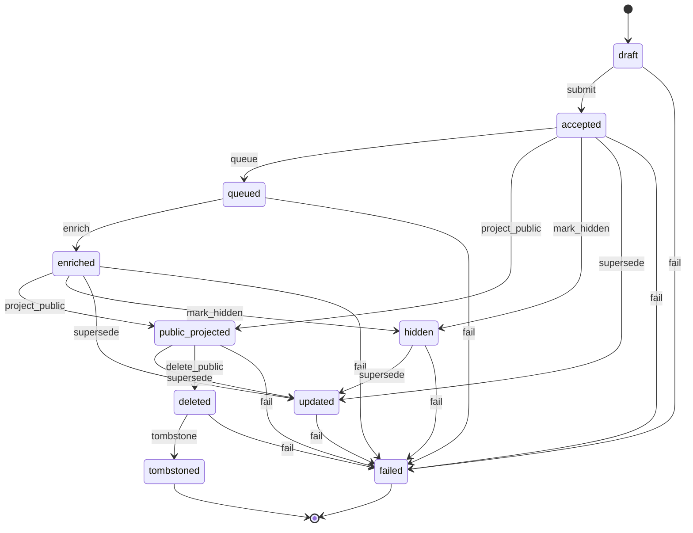

Hi! This is just my boring personal static blog ^w^ 

 

| Surface | Route |
| --- | --- |
| Production | `https://transscendsurvival.org` (Cloudflare Pages via proxied apex CNAME) |
| GitHub Pages manual rollback | `https://jesssullivan.github.io` / `static/CNAME` |
| Cloudflare Pages shadow | `https://tss.tinyland.dev` (development shadow) |
| Alternate Cloudflare shadow | `https://tss.ephemera.tinyland.dev` |
| Tailnet-only shadow | `https://jesssullivan-blog-shadow.taila4c78d.ts.net` |
| Tailnet vanity target | `https://jesssullivan-blog-shadow.tailnet.tinyland.dev` |

## Build Chain

The build produces a static SvelteKit artifact. Tinyland snapshots and local
Markdown remain first-paint, no-JS, and regression fixtures; canonical blog and
Pulse display hydrates in the browser from the public Tinyland broker when it is
available. `transscendsurvival.org` is the production consumer today and is served
by Cloudflare Pages through the proxied apex CNAME. GitHub Pages is retained only
as a disabled-by-default, explicitly manual rollback publisher.

## Icon Kit

Browser icons are generated from `https://github.com/Jesssullivan.png` by
`npm run icons:generate`. The script pins the fetched source at
`static/icons/favicon-source.jpg`, writes the favicon/Apple/Android/maskable
PNG set, emits the multi-size `favicon.ico`, and keeps the web app manifest,
Safari mask, and Microsoft tile config in `static/`.

## Checks And Deploys

## Bazel Gate

This repo uses the npm/SvelteKit workflow for normal local development and deployment. CI also carries a blocking Bazel lane, the `bazel-remote-gates` check, so check, test and Chromium e2e coverage are not proven only by local `npm`/`npx` commands.

- Since TIN-8703 the gate runs on the repository's own `tinyland-dind` runner with local Bazel execution. It uses no remote cache, no remote executor, no token and no credential helper. The check keeps its old name because branch protection requires it.
- CI calls `npm run gate:check`, `npm run gate:test` and `npm run gate:e2e`. They run the same public targets as the `remote:*:public` scripts through `scripts/local-bazel-gate.sh`, which selects `--config=local-gate`, passes `--ignore_dev_dependency`, and unsets any injected `BAZEL_REMOTE_*`, `GF_REAPI_*` or `GF_BAZEL_*` variable so a stale endpoint cannot route the build.
- The gate runs two Bazel jobs, one test at a time, a 2048 MiB Bazel server heap and a 1024 MiB heap per Node action. It restores a Bazel disk and repository cache keyed on the lockfiles and shuts the Bazel server down between phases.
- `npm run remote:check`, `npm run remote:test` and `npm run remote:e2e` still route through `scripts/bazel-cache-backed.sh` for developers who attach a GloriousFlywheel cache. That wrapper refuses to run without a valid `BAZEL_REMOTE_CACHE` and the expected substrate mode, and attaches `scripts/gf-reapi-bazel-credential-helper.mjs` only for a GF REAPI host.
- A default-owned exact-main workflow separately runs `//static/cv:pdfs_synced_test` with the read-only deploy key. The private `spear_resumes` repository never enters the PR graph.
- `//:sveltekit_check` runs the SvelteKit check path under Bazel.
- `//static/cv:pdfs_synced_test` byte-compares the checked-in resume/CV PDFs against the Bazel-built `spear_resumes` outputs; `.bazelrc` pins `SOURCE_DATE_EPOCH` and `TZ` so Tectonic output stays reproducible across local sync, shared-cache CI, and explicit executor proofs.
- `//:vitest_unit_tests` wraps the root and Pulse Vitest suites through `vitest.bazel.config.ts`.
- `//:blog_agent_node_tests` wraps the blog-agent `node:test` suite through `tsx --test`.
- `//:sveltekit_vite_build_smoke` runs a copied-workdir SvelteKit/Vite production build smoke. It proves the build target class, not the full npm prebuild/postbuild publication chain.
- `//:playwright_chromium_e2e` runs the Chromium Playwright e2e suite through Bazel with one worker. The CI gate provisions the package-lock-pinned Playwright browser before Bazel starts and passes its absolute executable path into the test action.
- `//:playwright_chromium_smoke` remains a narrow diagnostic target for browser runtime authority, not the remote e2e gate.
- `//:puppeteer_chromium_smoke` launches Puppeteer against the same pinned Chromium runtime path. It proves Puppeteer and Playwright consume one explicit browser authority rather than relying on an undeclared host path.
- `package-lock.json` remains the npm dependency authority for the app. `pnpm-workspace.yaml` makes the package importers explicit for Bazel, and `pnpm-lock.yaml` is the generated `rules_js` lock consumed by Bazel.
- Bazel npm lifecycle hooks skip Playwright and Puppeteer browser downloads. The CI gate provisions the lockfile-pinned Playwright browser outside Bazel actions.

Current boundary: the blog's own runner gates the public Bazel check/test/Chromium-e2e graph with local execution. A separate hosted default-owned workflow checks private CV PDF drift. Nothing in the gate uses remote execution. Production publication uses the exact-SHA Cloudflare Pages workflow; GitHub Pages is manual rollback only.

## Production DNS And Health

`transscendsurvival.org` is served by Cloudflare Pages at the apex and `www`,
with Cloudflare as the registrar, DNS authority, and DNSSEC signer as of
2026-06-23 (the registration moved off DreamHost). The declared Cloudflare zone
keeps both the apex and `www` as proxied CNAMEs to
`transscendsurvival-org.pages.dev`; `www` serves the blog with a canonical link
to the apex. DNSSEC is active — Cloudflare Registrar publishes the parent DS.

`npm run test:production-health` checks delegated authoritative DNS, major public
resolvers, direct HTTPS against resolved IPv4 targets, apex/`www` HTTPS responses
and redirects, live responses for the homepage plus slashless and trailing-slash
blog routes, the Tinyland blog broker contract, and browser hydration on `/blog`.
At the authoritative layer, apex and `www` must both expand to public A/AAAA
answers (Cloudflare anycast) for visitors. Direct operator-controlled DNS drift
checks assert the exact apex and `www` CNAME targets and proxy posture; the
legacy scheduled workflow is retired with no successor.
The static build keeps slashless canonical URLs but emits directory-index aliases
so copied, normalized, or legacy trailing-slash links do not 404. The
`Production Health v2` workflow runs every 30 minutes. It does not publish or
self-heal GitHub Pages. When `NTFY_TOPIC_URL` and optional `NTFY_TOKEN`
repository secrets are configured, it mirrors production-health failures to the
same ntfy topic used by the DNS guard Worker before failing the job. To prove
alert delivery without breaking the site, emit the typed `production-health-v2`
repository dispatch with `client_payload.send_ntfy_smoke="true"`; that sends a harmless ntfy smoke
notification and then runs the normal health checks.

This monitoring catches missing A/AAAA records, split-brain authority during
DNS changes, stale Cloudflare proxy targets that fail TLS, broken redirects, and
blog hydration regressions. Direct `scripts/cf-dns-check.mts` runs catch
record-level drift against `infra/cloudflare/zone.json`.

If production-health is red while apex routes and broker hydration pass, do not
weaken the checks. Reconcile live DNS/serving against
[docs/runbooks/dns-cutover-and-rollback.md](docs/runbooks/dns-cutover-and-rollback.md)
or change the desired posture in review first.

Automated stats commits and their Pages dispatch are retired. Stats generation
is parked as manual local work. Publication follows the canonical Cloudflare
production path and its exact-SHA CI and operator gates.

## Content Authority And Fallback Automation

Cross-repo collection is legacy/static intake for fallback content. It is not the
primary authoring path for Tinyland-managed posts.

## Brokered Display And Federation Boundary

## Pulse Lifecycle

